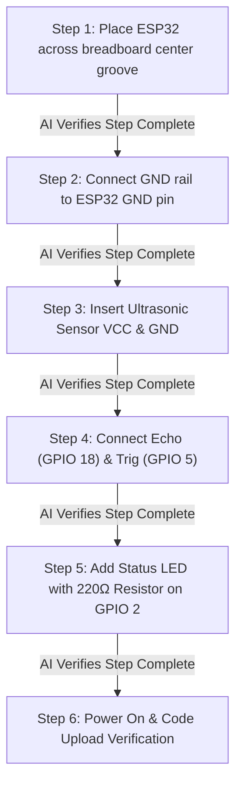
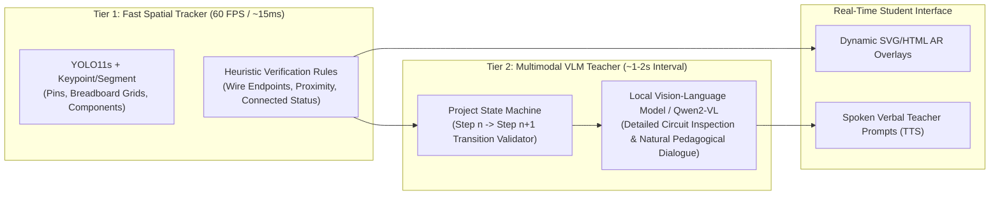

# Vision AI Studio: System Architecture, Current Implementation & Interactive AI Teacher Roadmap

> **Comprehensive Project Specification & Technical Roadmap**  
> *Last Updated: October 2026*  
> *Repository: IoT Lab Vision Intelligence & Real-Time Computer Vision Pipeline*

---

## Table of Contents
1. [Executive Summary & Vision](#1-executive-summary--vision)
2. [Complete Technical Stack](#2-complete-technical-stack)
3. [System Architecture & Dataflow](#3-system-architecture--dataflow)
4. [Current Implementation Log (What Has Been Built)](#4-current-implementation-log-what-has-been-built)
   - [Unified 1-Line Launcher & Process Lifecycle](#41-unified-1-line-launcher--process-lifecycle)
   - [Zero-Overhead In-Website Webcam Streaming](#42-zero-overhead-in-website-webcam-streaming)
   - [High-Accuracy Vision Engine (YOLO11)](#43-high-accuracy-vision-engine-yolo11)
   - [Class-Agnostic NMS & Domain False-Positive Filtering](#44-class-agnostic-nms--domain-false-positive-filtering)
   - [Temporal Bounding Box Smoothing (`TemporalTracker`)](#45-temporal-bounding-box-smoothing-temporaltracker)
   - [Modernized Glassmorphic UI & Clean Scene Strip](#46-modernized-glassmorphic-ui--clean-scene-strip)
   - [Real-Time Action & Scene Commentary Engine](#47-real-time-action--scene-commentary-engine)
   - [Voice Narration (Web Speech Synthesis)](#48-voice-narration-web-speech-synthesis)
5. [Next Update: Live Vision AI Teacher & Interactive Workshop Tutor](#5-next-update-live-vision-ai-teacher--interactive-workshop-tutor)
   - [5.1 The Concept & Pedagogical Goal](#51-the-concept--pedagogical-goal)
   - [5.2 Component Scanning & Automatic Project Ideation](#52-component-scanning--automatic-project-ideation)
   - [5.3 Step-by-Step Dynamic Instruction Graph](#53-step-by-step-dynamic-instruction-graph)
   - [5.4 Continuous Live Video Verification & Mistake Correction](#54-continuous-live-video-verification--mistake-correction)
   - [5.5 Teacher Feedback Multi-Modal Loop (Visual HUD + Verbal Teacher)](#55-teacher-feedback-multi-modal-loop-visual-hud--verbal-teacher)
   - [5.6 Technical Architecture & Implementation Plan for the Tutor Engine](#56-technical-architecture--implementation-plan-for-the-tutor-engine)
   - [5.7 Hardware Acceleration Blueprint: Leveraging the NVIDIA RTX A2000 GPU](#57-hardware-acceleration-blueprint-leveraging-the-nvidia-rtx-a2000-gpu)
6. [Summary of Files & Project Resources](#6-summary-of-files--project-resources)

---

## 1. Executive Summary & Vision

The **Vision AI Studio** is a low-latency, real-time computer vision and spatial intelligence pipeline. Designed to run completely on-device without external cloud dependencies, it bridges physical hardware experimentation (microcontrollers, sensors, breadboards, prototyping tools) with edge vision inference and natural language reasoning.

The platform transforms passive camera streaming into an **active situational awareness engine**:
- It identifies objects and human operators with state-of-the-art accuracy.
- It contextualizes movements, proximity, and multi-person interactions.
- It narrates scene events in real-time with zero lag.
- **Next Evolution**: It will act as an **autonomous, live AI Teacher** that scans physical components on a desk, proposes interactive project ideas, guides the student step-by-step through assembly, and continuously watches the live feed to catch and correct wiring and hardware mistakes in real time.

---

## 2. Complete Technical Stack

| Layer | Technologies & Frameworks | Description & Responsibilities |
|---|---|---|
| **Vision Inference Engine** | **PyTorch**, **Ultralytics YOLO11** (`yolo11n`, `yolo11s`, `yolo11m`, `yolo11x`), **OpenCV (`cv2`)**, **NumPy** | High-precision object regression, C3k2 & C2PSA attention modules, bounding box localization, custom training pipeline |
| **GPU Acceleration** | **NVIDIA RTX A2000 (12GB GDDR6 ECC VRAM)**, CUDA 12.x, TensorRT, cuDNN, FP16/INT8 | Hardware acceleration for sub-8ms YOLO11 inference & dual-resident 7B–11B Vision-Language Models (VLMs) |
| **Backend API & WebSockets** | **FastAPI**, **Uvicorn (ASGI)**, **AsyncIO**, **Pydantic v2**, **HTTPX** | Binary JPEG ingestion, async worker thread pools, full-duplex WebSocket hub, dynamic runtime model switching |
| **Spatial & Temporal Logic** | Custom Python Algorithms (`TemporalTracker`, `CommentaryEngine`) | IoU multi-frame tracking, exponential moving average (EMA) bounding box smoothing, Euclidean spatial proximity math, action trigger heuristics |
| **Edge SLM / Local Reasoning** | **Ollama**, **Qwen 2.5 1.5B** (or Llama 3.2 1B/3B) | Grounded scene summarization, natural language reasoning over spatial telemetry, zero-shot situational briefings |
| **Frontend Application** | **Next.js 14** (App Router), **React 18**, **TypeScript** | Real-time telemetry dashboard, reactive HTML5 canvas & SVG overlays, client-side state synchronization, auto-reconnecting WebSocket client |
| **Styling & Presentation** | **Tailwind CSS**, **Lucide Icons** | Dark glassmorphic design system (`slate-950`/`slate-900`), edge-clamped dynamic label badges, animated status indicators |
| **Audio & Speech Synthesis** | **Web Speech API** (`SpeechSynthesisUtterance`) | In-browser zero-latency text-to-speech for live spoken commentary and auditory alerts |
| **Firmware & IoT Hardware** | **ESP32-CAM (AI-Thinker)**, **OV2640 Sensor**, **FreeRTOS / C++**, **PlatformIO** | DMA frame capture, JPEG compression buffer, Wi-Fi HTTP multipart stream client |
| **DevOps & Orchestration** | **Python `subprocess`**, **Windows Batch (`.bat`)**, **PowerShell** | Unified single-command launcher, cross-platform port cleanup, graceful multi-tree process termination |

---

## 3. System Architecture & Dataflow

```mermaid
flowchart TD
    subgraph VideoSource["1. Video Ingestion Sources"]
        BrowserCam["In-Browser Webcam\n(Navigator getUserMedia)"]
        ESP32["Physical ESP32-CAM\n(FreeRTOS HTTP POST)"]
        OpenCVStream["Python Webcam Streamer\n(run_webcam.py)"]
    end

    subgraph BackendCore["2. FastAPI Core Backend (:8000)"]
        IngestRoute["/api/v1/telemetry/frame\n(Binary JPEG Ingestion)"]
        
        subgraph VisionEngine["Vision Intelligence Core"]
            YOLO["YOLO11 Model Backbone\n(yolo11s.pt / yolo11m.pt)"]
            NMSFilter["Class-Agnostic NMS\n(IoU=0.45, Conf=0.45)"]
            DomainFilter["Domain False-Positive Filter\n(Suppresses out-of-context COCO classes)"]
            Tracker["Temporal Tracker (EMA Alpha=0.70)\n(Debounce & Anti-Jitter)"]
        end

        subgraph EventEngine["Behavioral & Commentary Engine"]
            SpatialMath["Spatial Proximity & Vector Math\n(Person-to-Person Distance, Hand Proximity)"]
            ActionTrigger["Action Heuristics\n(Conversing, Moved Away, Entered, Device Usage)"]
            OllamaAgent["Local SLM Narration\n(Qwen 2.5 1.5B / Fast Template Fallback)"]
        end

        WSHub["WebSocket Broadcast Hub\n(/api/v1/ws/stream)"]
    end

    subgraph FrontendApp["3. Next.js 14 Dashboard (:3000)"]
        CanvasView["Video Viewport & Real-Time HTML HUD\n(Edge-Clamped Name Badges & Bounding Boxes)"]
        SceneOverview["Dynamic Scene Overview Strip\n(Visible Objects Only)"]
        LiveNarrator["AI Narrator Panel & Top Banner\n(Live Activity Timeline)"]
        SpeechSynth["Web Speech Synthesis\n(Spoken Audio Narration)"]
        ModelSelector["Runtime Model & Conf Controls"]
    end

    VideoSource --> IngestRoute
    IngestRoute --> YOLO
    YOLO --> NMSFilter --> DomainFilter --> Tracker
    Tracker --> SpatialMath --> ActionTrigger --> OllamaAgent
    Tracker --> WSHub
    OllamaAgent --> WSHub
    WSHub --> FrontendApp
```



---

## 4. Current Implementation Log (What Has Been Built)

### 4.1 Unified 1-Line Launcher & Process Lifecycle
- **Problem Solved**: Eliminated the need to manually open 3 terminal windows, activate virtual environments, and coordinate execution.
- **Solution**: Developed [`start.py`](file:///c:/Users/KIIT/Desktop/Object%20Detection/start.py), [`start.bat`](file:///c:/Users/KIIT/Desktop/Object%20Detection/start.bat), and [`stop.bat`](file:///c:/Users/KIIT/Desktop/Object%20Detection/stop.bat).
- **Features**:
  - Automatically targets `backend/venv/Scripts/python.exe`.
  - Concurrently boots FastAPI (`:8000`) and Next.js (`:3000`).
  - Actively polls `http://localhost:8000/health` until healthy before launching dependant services.
  - Automatically opens default browser to `http://localhost:3000`.
  - Clean signal trap (<kbd>Ctrl</kbd>+<kbd>C</kbd>) terminates entire process trees (avoiding orphaned Node/Uvicorn PIDs).
  - Added dedicated [`stop.bat`](file:///c:/Users/KIIT/Desktop/Object%20Detection/stop.bat) that frees ports `8000` and `3000` via PowerShell process discovery.

### 4.2 Zero-Overhead In-Website Webcam Streaming
- **Problem Solved**: Previously, camera feeds opened in a detached desktop OpenCV window (`cv2.imshow`), preventing an all-in-one web app experience.
- **Solution**: Refactored [`VideoCanvas.tsx`](file:///c:/Users/KIIT/Desktop/Object%20Detection/frontend/src/components/VideoCanvas.tsx) to default directly to in-browser webcam capture via `navigator.mediaDevices.getUserMedia`.
- **Features**:
  - Scales webcam frame buffer to standard 800px width with concurrency locks to prevent dropped frames.
  - Live video renders inside the HTML5 canvas with zero external window popups.
  - Switchable between **Laptop Camera (In-Website)** and **ESP32 / Remote Stream**.

### 4.3 High-Accuracy Vision Engine (YOLO11)
- **Problem Solved**: Baseline `yolov8n.pt` had high false-positive rates and frequently misclassified common indoor objects.
- **Solution**: Upgraded backend inference to **YOLO11** ([`detector.py`](file:///c:/Users/KIIT/Desktop/Object%20Detection/backend/app/services/detector.py)):
  - **`yolo11s.pt` (Small - 47.0 mAP)** as default backbone: fast 40–60ms steady-state CPU inference.
  - **`yolo11m.pt` (Medium - 51.5 mAP)** available for maximum precision.
  - **`yolo11n.pt` (Nano)** available for ultra-lightweight hardware.
  - Dynamic runtime model switcher accessible via UI dropdown without server restarts.

### 4.4 Class-Agnostic NMS & Domain False-Positive Filtering
- Enabled `agnostic_nms=True` with `iou=0.45` to prevent multi-class duplicate boxes (e.g. predicting both `cell phone` and `remote` on the same item).
- Implemented **Domain False-Positive Filtering**: suppresses exotic COCO classes (`airplane`, `boat`, `toilet`, `bird`, `fire hydrant`) common in small model hallucinations unless confidence exceeds 70%.
- Normalized labels into clean, human-friendly taxonomy.

### 4.5 Temporal Bounding Box Smoothing (`TemporalTracker`)
- Implemented an IoU-based multi-frame tracker inside [`detector.py`](file:///c:/Users/KIIT/Desktop/Object%20Detection/backend/app/services/detector.py).
- **Anti-Jitter Exponential Moving Average (EMA)** with $\alpha = 0.70$ provides smooth box transitions.
- **Temporal Debouncing**: requires lower-confidence detections to persist across at least 2 consecutive frames before rendering, eliminating 1-frame transient visual flashes.

### 4.6 Modernized Glassmorphic UI & Clean Scene Strip
- Replaced the hardcoded static inventory counters ("Dell Monitors: 0", "3D Printers: 0") with a **Live Scene Overview Strip** that only lists items currently visible in frame.
- Replaced broken SVG coordinate rendering with **hardware-accelerated HTML/CSS overlay badges** pinned on top of bounding boxes.
- Implemented edge-aware clamping: if an object touches the top border of the frame, the badge pins inside the upper box border rather than clipping off-screen.
- Upgraded whole dashboard theme to dark slate glassmorphism with custom scrollbars and responsive column layout.

### 4.7 Real-Time Action & Scene Commentary Engine
- Developed [`commentary_engine.py`](file:///c:/Users/KIIT/Desktop/Object%20Detection/backend/app/services/commentary_engine.py) to interpret temporal interactions and broadcast live narration:
  - **Social Interactions**: Measures Euclidean distance between persons; when $< 0.40$ normalized width, generates: *"Two people are standing close together and engaged in conversation."*
  - **Exits & Departures**: Detects count reductions and generates: *"Someone moved away (1 person remaining in view)"* or *"The person has moved away and left the camera view."*
  - **Arrivals & Entries**: Detects new entrants and announces: *"A person has walked into the scene."*
  - **Device Handling**: Identifies when mobile phones, laptops, or drinks are being actively manipulated.
  - **Broadcast Banner**: Floating pill displayed across the top of the video canvas with animated pulsing badges.

### 4.8 Voice Narration (Web Speech Synthesis)
- Added an interactive **Voice: ON/OFF** toggle to the UI.
- Uses the browser's native `window.speechSynthesis` API to speak commentary alerts out loud with zero latency and natural voice pitch.

---

## 5. Next Update: Live Vision AI Teacher & Interactive Workshop Tutor

> [!IMPORTANT]
> **Vision for the Next Phase**: Transition the system from an **observer/commentator** into an **active, continuous, interactive AI Teacher**. The system will scan available components, suggest DIY projects, generate step-by-step assembly diagrams, and continuously monitor live webcam footage to catch wiring/hardware errors in real time.

```
+-----------------------------------------------------------------------------------+
|                           THE LIVE AI TEACHER WORKFLOW                            |
+-----------------------------------------------------------------------------------+
|  [STEP 1: SCAN DESK]        [STEP 2: IDEATION]           [STEP 3: GUIDANCE]       |
|  Camera continuously      AI analyzes inventory &      Step-by-step assembly      |
|  scans parts on table     suggests matching projects   diagrams & instructions    |
|  (ESP32, DHT11, LED...)   ("Smart Temp Station")       shown on live HUD          |
|            |                          |                          |                |
|            +--------------------------+--------------------------+                |
|                                       v                                           |
|                     [STEP 4: CONTINUOUS LIVE TEACHER WATCH]                       |
|                     - Compares real wiring against project schematic              |
|                     - Detects polarity errors, wrong pins, loose wires            |
|                     - Spoken correction: "Move yellow wire from D4 to D5"         |
|                     - Highlights mistake in RED on live video feed                |
+-----------------------------------------------------------------------------------+
```

---

### 5.1 The Concept & Pedagogical Goal
When learning electronics or IoT prototyping, beginners face major hurdles:
1. They don't know what they can build with the random parts sitting on their desk.
2. Written tutorials are static and cannot verify if the student is following correctly.
3. Wiring mistakes (reverse polarity, wrong GPIO pin, missing pull-up resistor) can damage hardware or lead to silent failures.

The **Live Vision AI Teacher** solves this by acting like an experienced engineer sitting beside the student, watching every move, confirming correct steps, and gently intervening the second a mistake is made.

---

### 5.2 Component Scanning & Automatic Project Ideation

#### How it will work:
1. **Component Inventory Scanning**:
   - The user lays out their components on the desk (e.g. *ESP32, Breadboard, Ultrasonic Sensor HC-SR04, Jumper Wires, LED, 220Ω Resistor*).
   - The vision detector classifies each item, counts them, and builds a verified "Workbench Parts Inventory".
2. **Project Recipe Matching**:
   - The local reasoning agent compares the detected inventory against a library of project recipes (or queries the SLM/LLM).
   - Generates 3 tiered project recommendations:
     - **Beginner**: *Smart Distance Alarm* (Uses ESP32 + HC-SR04 + LED)
     - **Intermediate**: *Visual Parking Assistant*
     - **Custom/Freeform**: User enters an idea and the AI verifies whether the components on hand are sufficient.
3. **Interactive Project Selection**:
   - The user clicks **"Start Project"** on the dashboard.
   - The dashboard locks into **"Tutorial & Teacher Mode"**.

---

### 5.3 Step-by-Step Dynamic Instruction Graph

Once a project is active, the AI breaks it down into progressive, atomic verification steps:



- Each step provides:
  - **Visual Schematic**: High-resolution graphic overlay showing where the part goes.
  - **Action Goal**: A simple 1-sentence prompt (*"Insert the HC-SR04 sensor into columns E10 through E13"*).
  - **Expected Pinout Table**: Explicit pin correspondences (e.g., `VCC -> 5V`, `Trig -> GPIO 5`, `Echo -> GPIO 18`, `GND -> GND`).

---

### 5.4 Continuous Live Video Verification & Mistake Correction

This is the core differentiator: **continuous closed-loop visual supervision**.

#### Mistakes the AI Teacher will detect:
| Mistake Type | How the AI Teacher Detects It | Live Teacher Intervention |
|---|---|---|
| **Wrong GPIO Pin** | Bounding box / keypoint analysis detects wire plugged into GPIO 4 instead of GPIO 5 | *"Notice the yellow wire is plugged into GPIO 4. Move it one pin to the right into GPIO 5."* |
| **Reverse Polarity (VCC / GND Swap)** | Tracks red (power) and black (ground) wire destinations | ⚠️ *"Stop! Red power wire is connected to GND rail. Swap it immediately to prevent shorting."* |
| **Missing Current-Limiting Resistor** | LED connected directly from pin to GND without resistor | *"Your LED needs a 220Ω resistor in series to prevent burning out the diode."* |
| **Short Circuits across Breadboard** | Component inserted with both legs in the same conductive row | *"Both legs of the resistor are in row 12. Bridge it across two different rows."* |
| **Loose or Unseated Connections** | Sensor tilted or jumper wire floating above socket | *"The ultrasonic sensor is not fully pushed into the breadboard contacts."* |
| **Premature Power-Up** | USB cable connected before wiring is verified | *"Disconnect USB power until the wiring check is 100% complete."* |

---

### 5.5 Teacher Feedback Multi-Modal Loop (Visual HUD + Verbal Teacher)

```
+--------------------------------------------------------------------+
|  [LIVE WEBCAM VIEWPORT]                                            |
|                                                                    |
|    +--------------------+            +------------------------+    |
|    |  BREADBOARD        |            |  AI TEACHER HUD        |    |
|    |                    |            |                        |    |
|    |      [ESP32]       |            | Step 3 of 6:           |    |
|    |                    |            | Connect Ultrasonic     |    |
|    |   [!] WRONG PIN    |            | Sensor Trig Pin        |    |
|    |  +--------------+  |            |                        |    |
|    |  | Red Highlight|  |            | STATUS:                |    |
|    |  +--------------+  |            | [!] MISTAKE DETECTED   |    |
|    |                    |            +------------------------+    |
|    +--------------------+                                          |
|                                                                    |
|  [TEACHER VOICE]: "Careful! Move that jumper wire from Pin 4 to 5" |
+--------------------------------------------------------------------+
```

1. **Augmented Reality Bounding Overlays**:
   - **Green Glow**: Verified correct placement and connections.
   - **Red Pulsing Box**: Immediate visual highlight around the incorrect wire or pin.
   - **Guidance Arrow**: Projected SVG arrow pointing from where the wire currently is to where it *should* go.
2. **Interactive Audio Coaching**:
   - Natural, conversational voice tutoring via the Web Speech API.
   - Progressive hints:
     - *First attempt*: Gentle nudge (*"Take another look at the Trig pin wire."*)
     - *If uncorrected after 5s*: Explicit instruction (*"Your yellow wire is on GPIO 4. Move it one spot over to GPIO 5."*)
     - *On fix*: Immediate positive reinforcement (*"Perfect! That's correct. Now let's move to Step 4."*)
3. **Step Completion Checklist**:
   - Automatic green checkmarks appear on the side panel the instant the vision system verifies compliance.

---

### 5.6 Technical Architecture & Implementation Plan for the Tutor Engine

To implement this without compromising real-time performance, the Tutor Engine will use a **hybrid two-tier architecture**:



#### Key Modules to Develop:
1. **`training/data/electronics_components.yaml`**:
   - Dataset expansion for common electronics: `breadboard`, `esp32_devkit`, `hc_sr04`, `dht11`, `led_5mm`, `resistor_tht`, `jumper_wire_red`, `jumper_wire_black`, `jumper_wire_color`.
2. **`backend/app/services/tutor_engine.py`**:
   - Project curriculum graph parser (`projects.json` storing schematics and expected state signatures).
   - Step validator comparing detected pin coordinates with target pin locations.
   - State machine: `STEP_INTRO` $\rightarrow$ `STEP_IN_PROGRESS` $\rightarrow$ `MISTAKE_DETECTED` $\rightarrow$ `STEP_VERIFIED` $\rightarrow$ `PROJECT_COMPLETE`.
3. **`frontend/src/components/TeacherHUD.tsx`**:
   - Interactive split view: Live camera feed with AR wire guidance arrows + side schematic card.
   - Step progress bar and interactive "Hint" button.
4. **`frontend/src/components/ProjectPicker.tsx`**:
   - "Scan Workbench" mode: auto-detects parts on table and displays recommended DIY projects.

---

### 5.7 Hardware Acceleration Blueprint: Leveraging the NVIDIA RTX A2000 (12GB VRAM)

The availability of a dedicated workstation GPU with **12 GB GDDR6 ECC VRAM** (**NVIDIA RTX A2000 12GB**, Ampere Architecture with 3,328 CUDA Cores, 104 Tensor Cores, and 288 GB/s memory bandwidth) is a major architectural advantage. It completely eliminates memory bottlenecks and allows us to run **both heavy vision tracking AND high-parameter Vision-Language Models simultaneously in VRAM**.

#### 1. Instant Vision Engine Acceleration (TensorRT & FP16 CUDA)
- **Zero-Latency Video Processing**: Moving from CPU inference (~40–60 ms) to CUDA FP16 drops YOLO11 latency to **under 5–8 ms** (~120–160 FPS throughput).
- **Flagship Vision Backbone**: With 12GB VRAM, we can run **`YOLO11x` (Extra Large - 56.9M params)** at high native resolution (`1920x1080` or `1280x720`) to effortlessly localize microscopic pins, breadboard row coordinates, and fine component leads without any frame lag.

#### 2. Full-Tier On-Device Vision-Language Models (VLMs)
Unlike 4GB or 6GB systems that require aggressive 3-bit or 4-bit quantization, **12GB VRAM** allows high-precision, uncompromised multimodal models:
- **`Qwen2-VL-7B-Instruct` (INT8 / 8-bit or AWQ 4-bit with large context)**:
  - Top-tier open-source vision-language model.
  - Native visual grounding: can directly identify and segment micro-text (e.g. `ESP32-WROOM-32`, `ATmega328P`, `VCC/GND/D4/D5` silkscreen).
  - Can read resistor color-code bands (Brown-Black-Red = 1kΩ) and verify jumper wire endpoint insertions.
- **`MiniCPM-V 2.6` (8B params, INT4 / INT8)**:
  - SOTA dense visual comprehension and multi-image temporal analysis.
  - Capable of accepting sequential frame crops to watch the student's hands insert a wire in real time.
- **`Llama-3.2-Vision-11B` (Q4_K_M / AWQ)**:
  - Exceptional conversational fluency and pedagogical reasoning for the interactive teacher dialogue.

#### 3. Dual-Model VRAM Allocation Budget (12GB Profile)
Because we have 12GB of VRAM, both the 60+ FPS spatial tracker and the multi-modal reasoning engine can reside in GPU memory simultaneously with zero cold-starts or model-swapping latency:

| Model / Component | Precision / Quantization | VRAM Allocated | Latency Budget | Functional Role |
|---|---|---|---|---|
| **YOLO11x / YOLO11m Tracker** | FP16 (CUDA / TensorRT) | ~1.6 – 2.0 GB | **5 – 8 ms** | Real-time pin, wire, and component localization (60 FPS) |
| **Qwen2-VL-7B / MiniCPM-V 2.6** | INT8 / AWQ 4-bit | ~5.5 – 6.8 GB | **0.6 – 1.1 s** | Circuit verification, mistake detection & step validation |
| **Temporal Image Buffers** | FP16 (4–6 frames) | ~0.6 GB | Instantaneous | Multi-frame temporal hand action history |
| **Free VRAM Headroom** | — | **~2.6 – 4.3 GB** | — | System stability, dynamic token generation, zero OOM risk |
| **Total VRAM Capacity** | — | **12.0 GB** | — | *Comfortably accommodates entire dual-model stack* |

This hardware headroom transforms the project from a standard object detector into a **real-time, zero-compromise AI Engineering Lab Assistant** running 100% locally on your machine.

---

## 6. Summary of Files & Project Resources

- **Unified Launcher**: [`start.bat`](file:///c:/Users/KIIT/Desktop/Object%20Detection/start.bat) / [`start.py`](file:///c:/Users/KIIT/Desktop/Object%20Detection/start.py) / [`stop.bat`](file:///c:/Users/KIIT/Desktop/Object%20Detection/stop.bat)
- **Computer Vision Engine**: [`backend/app/services/detector.py`](file:///c:/Users/KIIT/Desktop/Object%20Detection/backend/app/services/detector.py)
- **Live Scene Commentary**: [`backend/app/services/commentary_engine.py`](file:///c:/Users/KIIT/Desktop/Object%20Detection/backend/app/services/commentary_engine.py)
- **FastAPI Routing & WebSockets**: [`backend/app/api/routes.py`](file:///c:/Users/KIIT/Desktop/Object%20Detection/backend/app/api/routes.py)
- **Next.js Real-Time Viewport**: [`frontend/src/components/VideoCanvas.tsx`](file:///c:/Users/KIIT/Desktop/Object%20Detection/frontend/src/components/VideoCanvas.tsx)
- **Dashboard Root Page**: [`frontend/src/app/page.tsx`](file:///c:/Users/KIIT/Desktop/Object%20Detection/frontend/src/app/page.tsx)
- **Speech & Narration Ticker**: [`frontend/src/components/CommentaryTicker.tsx`](file:///c:/Users/KIIT/Desktop/Object%20Detection/frontend/src/components/CommentaryTicker.tsx)
- **YOLO Trained Weights**: [`models/yolo11s.pt`](file:///c:/Users/KIIT/Desktop/Object%20Detection/models/yolo11s.pt) & [`models/yolo11m.pt`](file:///c:/Users/KIIT/Desktop/Object%20Detection/models/yolo11m.pt)

---

*This document serves as the master specification and architectural roadmap for future development of the Live Vision AI Teacher system.*
